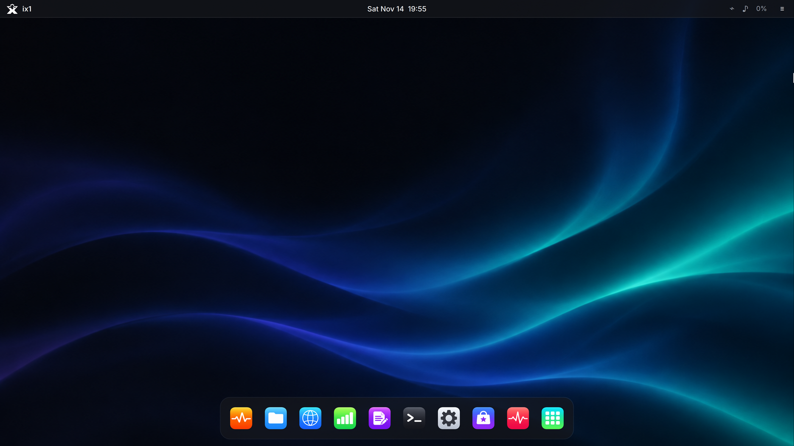
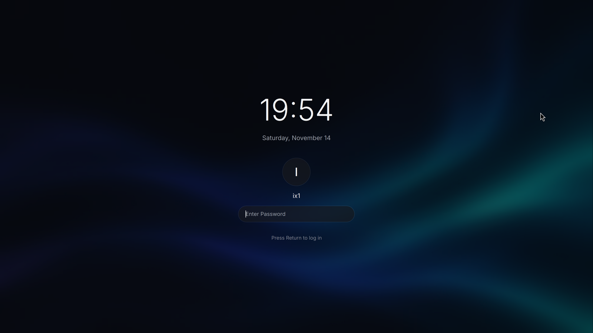

<p align="center">
  
</p>

<h1 align="center">ix1</h1>

<p align="center">
  <strong>A desktop that maintains itself.</strong><br>
  An independent, free, Fedora-based desktop operating system for x86-64.
</p>

<p align="center">
  <a href="https://dxxpcode.github.io/ix1/">Website</a> ·
  <a href="https://github.com/dxxpcode/ix1/releases">Releases</a> ·
  <a href="documentation/">Docs</a>
</p>

<p align="center">
  
</p>

## What it is

- **A desktop, designed.** Custom Qt 6 / QML shell over KWin (Wayland) — frosted panel, dock, launcher, lock screen.
- **An image, not a pile of packages.** The whole OS is a Fedora **bootc** container image. Updates are atomic, signed, and roll back cleanly.
- **Curated, not closed.** Flatpak for third-party apps; SELinux enforcing out of the box.

## Try it

Grab the ISO, checksums, and signatures from the [website](https://dxxpcode.github.io/ix1/) or [releases](https://github.com/dxxpcode/ix1/releases). The ISO ships in three parts (GitHub's 2 GB asset limit):

```bash
cat ix1-0.8.0-x86_64.iso.part* > ix1-0.8.0-x86_64.iso   # join the parts
qemu-system-x86_64 -m 4096 -enable-kvm -cdrom ix1-0.8.0-x86_64.iso   # try it in QEMU
```

## The journey

<p align="center">
  
</p>

| | |
|---|---|
| ✓ **M0** | Product & technical specification — [technical plan](documentation/technical-plan.md) |
| ✓ **M1** | OS foundation — bootc image, branding, first boot |
| ✓ **M2** | Bootable system in QEMU — display, input, session |
| ✓ **M3** | Installer — guided disk setup, real installs to disk |
| ✓ **M4** | Desktop environment — shell, dock, launcher, panel, lock screen |
| ✓ **M5** | Essential applications — files, terminal, editor, browser, settings |
| ✓ **M6** | App ecosystem — Flatpak, software center, portals |
| ✓ **M7** | Updates & recovery — signed atomic updates, rollback, retention |
| ✓ **M8** | Quality assurance — full-stack test pass, [evidence](tests/qa/evidence/) |
| ✓ **M9** | Release — ISO, checksums, signatures, [website](https://dxxpcode.github.io/ix1/) |
| ▶ **Next** | First-run onboarding (in design), continued polish |

See [`documentation/milestone-tests.md`](documentation/milestone-tests.md) for the acceptance test each milestone had to pass.

## How it works

| Layer | Technology |
|---|---|
| OS image | Fedora 44 **bootc** container — the filesystem is the image |
| Updates | `bootc` atomic upgrades, cosign-signed, automatic rollback |
| Desktop | Custom Qt 6 / QML shell on **KWin (Wayland)** — [design system](documentation/design-system.md) |
| Apps | First-party apps + **Flatpak** for everything else |
| Security | SELinux enforcing, signed images, minimal surface |

See [`documentation/architecture.md`](documentation/architecture.md) for the full picture.

## Develop

This repository is the monorepo for the whole system:

```
distribution/   bootc image, packages, branding, installer, release
desktop/        shell, dock, launcher, panel, settings, design system
applications/   first-party apps (files, software center, ...)
system/         boot, services, networking, storage, security, updates
platform/       portals, permissions, application integration
infrastructure/ registry, signing, CI, website
tests/          boot, installer, desktop, applications, security, updates
documentation/  specs, plans, ADRs
scripts/        build and test helpers
```

```bash
./scripts/build-image.sh     # build the bootc container image
```

Boot testing in QEMU: see [`tests/boot/README.md`](tests/boot/README.md).

---

<p align="center"><sub>ix1 — independent, free, and under active development.</sub></p>
